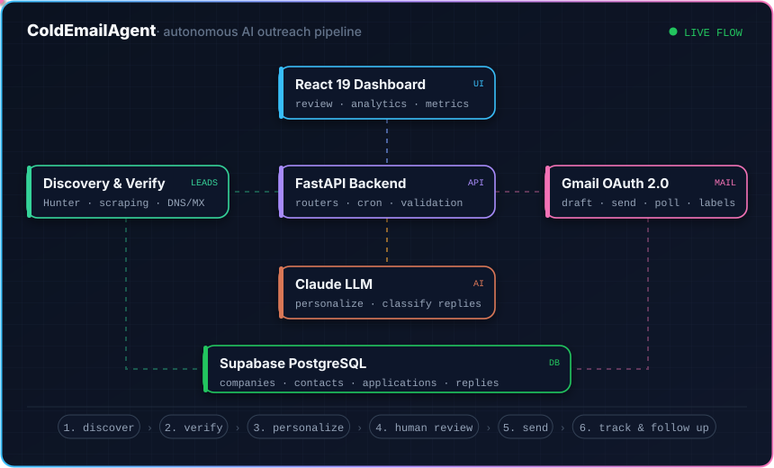

<!-- ===================== HEADER ===================== -->

  

  
  
  

  
  
  

  

---

## 👋 About Me

I'm a **Software Engineer at Bank of America** who loves shipping things end-to-end — from backend APIs and clean architecture to polished mobile/web UIs and the AI layer on top.

- 🏦 **Day job:** building reliable, enterprise-grade software in the banking domain
- 🤖 **After hours:** building **AI agents** and LLM-powered products (Claude, real-time code analysis, automation pipelines)
- 🧱 **I care about:** Clean Architecture, scalable APIs, great developer experience, and UX that feels fast
- 🧠 **Foundations:** Data Structures & Algorithms, competitive programming, and Machine Learning
- ⚡ **Fun fact:** I automate anything I have to do more than twice

---

## 🚀 Featured Projects

<table>
<tr>
<td width="50%" valign="top">

### 🧠 [NexCode AI](https://github.com/shivam24-2000/AI-Powered-Coding-Interview-Preparation-Platform-with-Real-Time-Code-Analysis)
AI-powered technical interview platform with **real-time code analysis** and a **live AI video mock interviewer** that asks follow-ups based on your code.

- Language-aware AI completion across **11+ languages**
- **150+ DSA snippet** registry
- Voice or typed answers with live speech-to-text

  

</td>
<td width="50%" valign="top">

### 📬 [ColdEmailAgent](https://github.com/shivam24-2000/ColdEmailAgent)
An **autonomous AI agent** that runs the full outreach pipeline — lead discovery, hyper-personalized emails with **Anthropic Claude**, human-in-the-loop review, Gmail dispatch and smart follow-ups.

- DNS MX + SMTP verification to prevent bounces
- React 19 review & analytics dashboard
- Gmail OAuth 2.0 with reply monitoring

  

</td>
</tr>
<tr>
<td width="50%" valign="top">

### 🛒 [SmartCart](https://github.com/shivam24-2000/smart-cart)
Mobile app comparing grocery prices **in real time** across Blinkit, Zepto, Swiggy Instamart and more.

- Pincode-based pricing engine
- **Split-cart optimizer** to find the cheapest store combination
- Playwright scraping backend + Supabase auth

   

</td>
<td width="50%" valign="top">

### 🎬 [Movies Backend Services](https://github.com/shivam24-2000/Movies_Backend_Services) + [JWT Auth](https://github.com/shivam24-2000/JWT-TokenCreation-Authorization)
RESTful backend services in **ASP.NET Core Web API** with Entity Framework and **JWT-based authentication & authorization**.

- Clean, layered architecture
- Secure token issuing & role-based access
- EF Core data access & CRUD

  

</td>
</tr>
</table>

### ⚙️ Under the hood — how ColdEmailAgent works

  

<b>🔬 More projects — Machine Learning & Computer Vision</b>

 

| Project | What it does | Stack |
|---|---|---|
| [Image Steganography](https://github.com/shivam24-2000/Image-Steganography) | Hide and recover secret messages inside images | Python |
| [Facial Emotion Recognition](https://github.com/shivam24-2000/Facial_emotion_recognition) | Classifies emotions from facial images | Python, Deep Learning |
| [Body Language Decoder](https://github.com/shivam24-2000/Body-language-Decorder) | Detects body-language cues from pose landmarks | Python, OpenCV |
| [Gesture Recognition](https://github.com/shivam24-2000/Gesture-Recognition) | Real-time hand gesture recognition | Python, OpenCV |
| [Comment Toxicity](https://github.com/shivam24-2000/Comment_Toxicity) | Flags toxic comments with NLP | Python, TensorFlow |
| [Email Spam Classifier](https://github.com/shivam24-2000/Email-Spam-Classifier) | Spam vs. ham email classification | Python, scikit-learn |
| [Movie Recommender](https://github.com/shivam24-2000/movie-recommender-system) | Content-based movie recommendations | Python, pandas |
| [Trekr](https://github.com/shivam24-2000/Trekr) | iOS app | Swift |

---

## 🛠️ Tech Stack

<b>Languages</b>  
  

<b>Backend & Frameworks</b>  
  

<b>Data, AI & ML</b>  
  

<b>Tools & Platforms</b>  
  

---

## 📊 GitHub Analytics

  
  

  

  <picture>
    <source media="(prefers-color-scheme: dark)" srcset="https://raw.githubusercontent.com/shivam24-2000/shivam24-2000/output/github-snake-dark.svg" />
    <source media="(prefers-color-scheme: light)" srcset="https://raw.githubusercontent.com/shivam24-2000/shivam24-2000/output/github-snake.svg" />
    
  </picture>

---

## 🤝 Let's Build Something

I'm always happy to talk about **backend systems, AI agents, and product engineering** — or a role where I can make an impact.

  <a href="mailto:shivamsinghal24@gmail.com"><b>📫 shivamsinghal24@gmail.com</b></a> &nbsp;•&nbsp;
  <a href="https://linkedin.com/in/shivam-singhal-538369191"><b>💼 LinkedIn</b></a> &nbsp;•&nbsp;
  <a href="https://shivam-singhal.vercel.app/"><b>🌐 Portfolio</b></a>

